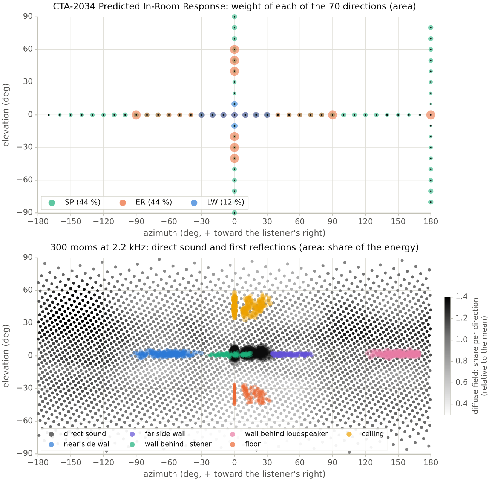
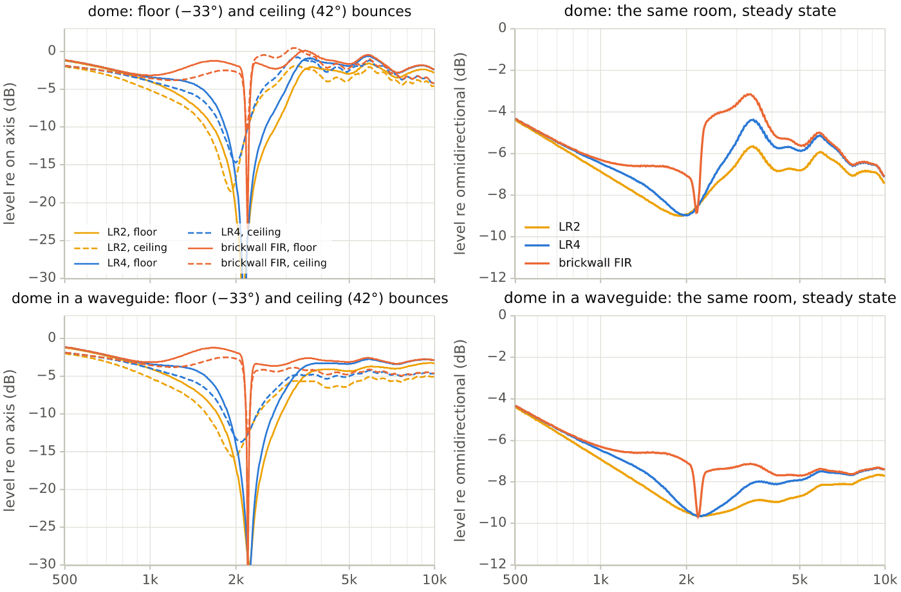

# CTA-2034 in simulated rooms: what the listener receives, direction by direction

A simulation study of the spatial averages of ANSI/CTA-2034-A (the "spinorama") in 300 domestic
listening rooms, and of a two-way loudspeaker crossed over with Linkwitz-Riley or brickwall FIR
filters.



CTA-2034 reduces a loudspeaker to 70 far-field measurements on two orbits and combines them into
curves: the Listening Window (LW), the Early Reflections (ER), the Sound Power (SP) and their mix,
the Predicted In-Room Response, `PIR = 0.12 LW + 0.44 ER + 0.44 SP`. Each curve is a weighted mean of
the power radiated in those 70 directions. A room does the same: the energy reaching the listener
is a sum, over the paths, of the power the loudspeaker sends in each path's direction, weighted by
the path's spreading and absorption. The study computes the rooms' weights and sets them against
the standard's.

It started from three hypotheses:

1. the standard gives the vertical directions less weight than a room does, since rooms are wider
   than high and floors and ceilings are harder to treat than walls;
2. the Listening Window was drawn to hide the lobing of low-slope passive crossovers;
3. a weighting closer to the energy actually received would show that a brickwall crossover
   removes most of the off-axis colouration of a Linkwitz-Riley one.

The first does not hold in these rooms. The second holds in another form: the Listening Window's
narrow vertical extent matches where listeners sit, but the averaging every curve shares, the room's
own average included, fills the notches a crossover digs into each reflection, and flatters
low-slope crossovers most. The third holds for the floor and ceiling reflections, read path by path;
the in-room curve becomes smoother only when the drivers' directivities match at the crossover. On
the way, the PIR turns out to give the first reflections about four times the weight they have in a
room, and the two-orbit sound power shows only about half of the power lost to the lobing between
the drivers. The report, with every
formula, is [`paper/main.pdf`](paper/main.pdf); a French version is
[`paper/main_fr.pdf`](paper/main_fr.pdf).

## The simulation

- **Loudspeaker**: an upright two-way bookshelf, 200 × 360 × 280 mm: a 6.5-inch cone (flat piston of
  129 cm²) below a 1.1-inch dome (the 28 mm dome of the turntable study), 140 mm apart, crossed over
  at 2.2 kHz. Variant: the same dome in a waveguide whose directivity matches the cone's at the
  crossover and stays constant above. Cabinet diffraction by the Distributed Edge Dipole model of
  the [turntable study](https://github.com/Arnwald/turntable-rotation-center-study), evaluated in the
  far field over the whole sphere. Each driver is equalized to its acoustic target on the reference
  axis: Linkwitz-Riley of order 2, 4 or 8, or the brickwall linear-phase FIR of the four-way article
  (1501 taps at 93.75 kHz, Kaiser β = 8, high-pass made as an impulse minus the low-pass). Upright,
  and on its side for the rotation test.
- **Rooms**: 300 shoeboxes drawn at random, 3.4–5.2 m wide, 4.5–7.5 m long, 2.4–2.8 m high;
  loudspeakers 0.4–1.2 m from the wall behind them, 1.8–2.8 m apart, aimed at the listener or not;
  listener 2.0–3.8 m away, ears 1.0–1.25 m high. Plaster or plasterboard, a window with curtains,
  parquet, tiles (with or without a rug) or carpet, 6–16 m² of furniture absorption; a quarter of the
  rooms has absorbing panels at the side walls' first reflection points. T60 at 1 kHz: 0.40 s
  median (0.26–0.68 s).
- **Room model**: specular images up to the third order, with their exact directions, absorption and
  scattering, and a diffuse field fed by the energy each direction scatters, traced through the box
  (the Hopkins-Stryker room term with a direction-dependent first part). It agrees with a full image
  method (25 000 to 90 000 images) within 3 to 7 % of the energy, and with Hopkins-Stryker.
- **In-room responses** are given relative to an omnidirectional source at the same place, so that
  the room's own colouration divides out: in steady state, and for the early sound alone (direct
  sound and first reflections). 150 Hz to 20 kHz, 1/96 octave. The first 150 rooms fit the updated
  weights, the other 150 test them.

## Main results

### The standard against the rooms

| Share of the energy at the listener (omnidirectional source, 1 kHz) | rooms, median (10–90 %) | CTA-2034 PIR |
|---|---|---|
| direct sound | 6.6 % (3.5–12.2) | LW: 12 % |
| first reflections | 11 % | ER: 44 % |
| … of them, floor and ceiling | 41 % (33–52); 50 % in treated rooms | 40 % (2 bounces of 5) |
| everything after the first reflections | 82 % | SP: 44 % |

| Predicting the steady-state in-room response (150 test rooms, 16 loudspeaker variants, 300 Hz–16 kHz) | RMS error, median | largest mean error |
|---|---|---|
| CTA-2034 PIR, 0.12 LW + 0.44 ER + 0.44 SP, two orbits | 1.70–2.11 dB | 2.53–2.91 dB |
| same weights, sound power of the sphere | 1.65–1.99 dB | 2.21–2.62 dB |
| fitted, two orbits: 0.08 LW + 0.02 ER + 0.90 SP | 0.44–0.72 dB | 0.63–0.98 dB |
| fitted, sphere: 0.11 LW + 0.01 ER + 0.89 SP | 0.45–0.74 dB | 0.41–0.57 dB |
| mean of the 150 training rooms (the room-to-room floor) | 0.43–0.69 dB | |

- **The vertical directions are not under-weighted.** Floor and ceiling bring 41 % of the energy of the
  first reflections, the share CTA-2034's Early Reflections give them (two bounces of five). Their
  reflections leave the loudspeaker at −35° (−41 to −29°) and +45° (+38 to +52°) and arrive first,
  1.9 and 3.6 ms after the direct sound, as expected in rooms wider than high; the standard's angles
  bracket them. Where the side walls are treated their share rises to 50 %. The standard's rear-wall
  bounce (±90°, 180°) misses the actual path (137 to 166°).
- **The Listening Window's narrow vertical extent is not what hides vertical lobing.** Seated listeners hear the
  direct sound within 5° of the axis vertically, and up to 24° horizontally when the loudspeakers
  are not aimed at them. Laid on its side, the same loudspeaker leaves a quarter of the listeners
  with an early sound more than 3 dB below the median at the crossover, one in ten 5.7 dB below;
  upright, none is more than 1.1 dB below. The Listening Window's ±30° horizontal and ±10° vertical
  follow that asymmetry. The vertical lobing reaches the listener through the floor and ceiling
  reflections and the reverberant field, which ER and SP carry, averaged: the averaging is what hides
  it (below).
- **The PIR gives the first reflections four times their weight in a room.** In steady state the room
  is mostly sound power: weights fitted to the rooms are about 0.1 LW + 0.9 SP (0.07–0.16 for LW in
  treated, dead, live, near or far subsets; ER near zero). The CTA PIR sits 0.8 dB above the rooms
  at 300 Hz and up to 2.6 dB above near the crossover; the fitted weights predict the test rooms as
  well as their own mean does. For the early sound alone, the rooms weigh about 0.40 LW + 0.53 ER,
  where the standard's early part is 0.21 LW + 0.79 ER.
- **The sound power from two orbits misses the lobing.** The horizontal orbit of an upright loudspeaker
  sees no interference between its drivers and gets half the weight, where only a thin band of the
  sphere is free of it: the two-orbit SP of the two-way is 1.7–1.8 dB too high at the crossover with
  LR2, LR4 or LR8. At 2 kHz the LR4's sound power falls 2.6 dB below the brickwall's (the lobing);
  the two orbits show 1.2 dB of it. Even for a source symmetric about its axis, the standard's weights overestimate
  a directional one (0.45 dB for a piston at ka = 3).

### Linkwitz-Riley against brickwall FIR



A crossover's defects lie within about an octave of its frequency, and in each direction at a
frequency of its own (the drivers cancel where their path difference is half a wavelength). Adding
directions in power, as the in-room curve and every CTA-2034 curve do, adds notches at different
frequencies and fills them. Two measures, both within one octave of the 2.2 kHz crossover (RMS
deviation in dB from the straight line that fits the curve from 600 Hz to 8 kHz):

- the **averaged curve** (the rooms' steady-state response, the PIR);
- the **paths**: the same deviation for the response in each direction, before any averaging,
  weighted by the energy the path brings to the listener; the weights are the same for every
  crossover (the power averaged over the four), so that a notch does not lower the weight of the path
  it colours.

| Plain dome (waveguide) | LR2 | LR4 | LR8 | brickwall FIR |
|---|---|---|---|---|
| averaged curve, rooms | 1.11 (0.81) | 1.36 (0.95) | 1.48 (0.92) | 1.32 (0.48) |
| averaged curve, rooms, deepest dip | 1.9 (1.4) | 2.4 (1.8) | 2.7 (2.2) | 3.0 (2.5) |
| paths, every path | 2.41 (1.80) | 2.25 (1.65) | 2.13 (1.45) | 1.62 (0.83) |
| paths, first reflections | 3.13 (2.37) | 2.75 (2.11) | 2.44 (1.81) | 1.70 (0.99) |
| paths, floor and ceiling bounces | 5.51 (4.54) | 4.58 (3.99) | 3.67 (3.35) | 1.86 (1.58) |
| floor and ceiling bounces, deepest dip | 15.2 (11.3) | 12.7 (10.7) | 11.7 (10.9) | 10.4 (11.7) |

(dB; medians of the 300 rooms.)

- **The averages flatter the low-slope crossover.** In one living room the floor bounce of the LR4
  two-way has a notch 41 dB deep and 611 Hz wide at −6 dB (745 Hz with LR2); the room's averaged
  response keeps a dip of 2 to 3 dB. Over the 300 rooms the averaging divides the colouration of the
  floor and ceiling bounces by 3.4 with LR4, by 5 with LR2, by 1.4 with the brickwall: the averaged
  curve and the PIR rank LR2 as the smoothest Linkwitz-Riley crossover, while its reflections are the
  most coloured.
- **Path by path, the brickwall removes about 60 % of the colouration of the floor and ceiling
  bounces** (59 % with the plain dome, 60 % with the waveguide), 38 and 53 % for all the first
  reflections, 28 and 50 % for every path. Its notches are as deep, ten to thirteen times narrower (48
  Hz instead of 611 Hz at the floor bounce): about a thirtieth of an octave instead of a third.
- **The averaged curve improves only when the directivities match.** With the plain dome the 6.5-inch
  cone beams at 2.2 kHz while the dome does not: the brickwall replaces the broad LR4 dip by a step of
  about 3 dB and a narrow notch. With the waveguide there is no step left, and the deviation halves.
- **The standard's weights** give the paths' colouration less weight than the rooms do (1.73 against
  2.25 dB with the dome and LR4) and show a slightly smaller gain from the brickwall (22 against 28 %
  with the plain dome, 47 against 50 % with the waveguide). No weighting undoes the averaging: the
  colouration of a reflection has to be read in its own direction, −30 to −40° and +40 to +50° for the
  floor and ceiling at usual listening distances.

## Reproduce

Rust (stable) and, for the report, a LaTeX distribution with latexmk:

```sh
make test      # unit and integration tests
make study     # every simulated quantity (about 20 seconds on 8 cores, results/study.bin)
make figures   # figures and tables in paper/, in English and in French
make paper     # paper/main.pdf and paper/main_fr.pdf
```

The 300 rooms and the three named ones are in `data/rooms.json`.
`cargo run --release --bin study -- --npy` also writes the main arrays as NumPy files in
`results/npy/`.

## Layout

| path | content |
|---|---|
| `src/speaker.rs` | the two layouts, far field over the sphere with Distributed Edge Dipole diffraction |
| `src/directivity.rs` | piston, dome and constant-directivity (waveguide) radiators |
| `src/crossover.rs` | LR2, LR4, LR8 and brickwall FIR targets, on-axis equalization |
| `src/cta2034.rs` | the CTA-2034-A curves and the weight they give to each of the 70 directions |
| `src/room.rs` | shoebox rooms: images, absorption, scattering, rays and the diffuse field |
| `src/ensemble.rs` | materials, the random ensemble, three named rooms |
| `src/study.rs` | rooms as weights over directions, loudspeaker variants |
| `src/analysis.rs` | in-room responses, fitted weights, prediction errors, colouration metrics |
| `src/figures.rs`, `src/tables.rs`, `src/plot.rs` | the report's figures (SVG drawn with plotters, converted to PDF and PNG) and tables |
| `src/signal.rs`, `src/special.rs`, `src/sphere.rs` | frequency grids, minimum phase, smoothing, special functions, splines, directions on the sphere |
| `src/bin/` | `study` (the simulation) and `figures` (figures and tables) |
| `tests/` | integration tests; the modules carry their unit tests |
| `data/` | the setups of the study (`rooms.json`) and the DejaVu Sans font of the figures |
| `paper/` | LaTeX report in English (`main.tex`) and French (`main_fr.tex`), figures and generated tables (French ones in `fr/`) |

## Notes

The curves follow CTA-2034-A as it is commonly implemented (ER as the mean of its five bounces).
CTA-2034-B was published in July 2024; what it changed was not checked here. The rooms are simulated,
with textbook coefficients; the steady-state energy is a spatial average (paths added in power).
The colouration metrics are physical measures, not perceptual ones. The study was first written
in Python; the Rust version reproduces its tables and quoted numbers exactly.

## License

Code under the MIT license. The DejaVu Sans font in `data/fonts/` has its own license
(`data/fonts/LICENSE_DEJAVU`).
